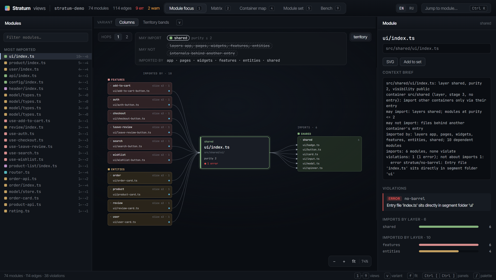
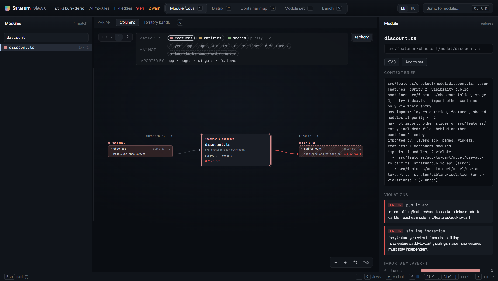
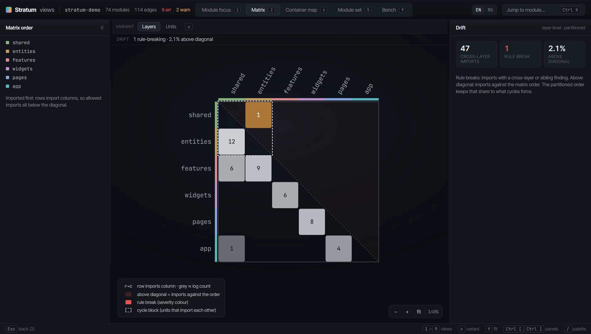

<div align="center">


# Stratum

**A universal architecture linter for TypeScript, JavaScript and Vue.**<br/>
Fast enough to run on every edit, written for AI coding agents and CI.

[](https://github.com/PetukhovArt/stratum/actions/workflows/ci.yml)
[](https://www.npmjs.com/package/@petukhovart/stratum-lint)
[](LICENSE)
[](https://github.com/PetukhovArt/jig)

<a href="docs/assets/visualizer-focus.webp"></a>

</div>

## Why Stratum

- **Any architecture.** Layers, slices, segments and private zones come from your config or a preset (`stratum:recommended`, `stratum:fsd`). No folder name is wired in.
- **24 rules out of the box.** Cross-layer imports, cycles, public API bypass, sibling coupling, import policies, restricted calls, folder structure, unused exports and unreachable modules. Custom rules in Rhai, no rebuild.
- **Every finding says what to do.** Each one carries a `fix`, so an agent repairs it without asking.
- **Fast.** Rust, a graph cache and a git-aware scope: about 0.15 s for the changed files of a 4,000-module project. Works offline.
- **Adopt on a legacy codebase.** `baseline` accepts what exists today; later runs report only new violations, and `diff --base main` shows what a merge request changes.
- **See it.** `stratum-lint visualize` opens the dependency graph, the layer matrix and the container map in the browser.

## Quick start

```sh
npm install -g @petukhovart/stratum-lint
stratum-lint init                         # write a config inferred from your folders
stratum-lint --changed --format agent     # check what you changed
```

```text
stratum: 9 errors, 2 warnings, 27 info, 0.08s
error stratum/public-api (1) - stratum-lint explain stratum/public-api
  src/features/checkout/model/discount.ts:1 -> src/features/add-to-cart/model/use-add-to-cart.ts  Import of `src/features/add-to-cart/model/use-add-to-cart.ts` reaches inside `src/features/add-to-cart`
  fix: Import from `src/features/add-to-cart` through its entry `src/features/add-to-cart/index.ts`, exporting the name there if it is missing.
warning stratum/no-cross-layer-import (1) - stratum-lint explain stratum/no-cross-layer-import
  src/shared/lib/analytics.ts:1 -> src/entities/user/index.ts  Module imports from layer 'entities' which 'shared' does not depend on
  fix: Move the imported symbol into a layer 'shared' may reach, or add 'entities' to 'shared'.depends_on if the dependency is legitimate.
```

<table>
<tr>
<td width="50%"><a href="docs/assets/visualizer-violation.webp"></a></td>
<td width="50%"><a href="docs/assets/visualizer-matrix.webp"></a></td>
</tr>
<tr>
<td align="center"><sub>Every violation, with the rule and the layers the module may import</sub></td>
<td align="center"><sub>Layer matrix: imports against the order sit above the diagonal</sub></td>
</tr>
</table>

## Part of jig

Stratum is the architecture gate of **[jig](https://github.com/PetukhovArt/jig)**, a harness for AI coding agents. jig runs Stratum after each edit and blocks the end of a turn while new errors remain. Stratum works on its own too:

| Where | How |
|---|---|
| Claude Code | the [`stratum` plugin](claude-plugin/README.md); optional warm diagnostics through [`stratum-lsp`](claude-plugin-lsp/README.md) |
| Codex, Cursor, other agents | paste [docs/agents-snippet.md](docs/agents-snippet.md) into `AGENTS.md` |
| GitLab, GitHub CI | native report formats and a baseline check: [docs/ci.md](docs/ci.md) |
| Any tool | the JSONL contract and exit codes: [docs/harness.md](docs/harness.md) |

<details>
<summary><b>Install</b></summary>

- npm, all platforms: `npm install -g @petukhovart/stratum-lint` (ships `stratum-lint` and `stratum-lsp`)
- Windows: `scoop bucket add stratum https://github.com/PetukhovArt/scoop-stratum-bucket`, then `scoop install stratum-lint`
- macOS (Apple silicon), Linux (x64): `brew tap petukhovart/stratum`, then `brew install stratum-lint`
- From source: `cargo install --path crates/stratum-lint` and `cargo install --path crates/stratum-lsp`

Source files: `.ts .tsx .mts .cts .js .jsx .mjs .cjs .vue` (Vue: `<script>` and `<script setup>`).

</details>

<details>
<summary><b>Rules</b></summary>

`stratum-lint rules` lists the active ones; `stratum-lint explain <slug>` prints what, why, fix and options.

| Rule | Reports |
|---|---|
| `stratum/no-cross-layer-import` | An import from a layer outside the importer's own layer and its `depends_on`. |
| `stratum/no-circular-deps` | Every import cycle, one violation per cycle. |
| `stratum/purity` | A module importing a less pure one (`// @stratum-purity N`, 1 pure to 4 side effects, default 2). |
| `stratum/visibility-scope` | An import into a private-zone folder from outside that folder's parent. |
| `stratum/public-api` | An import from outside a slice, sub-unit or nested container that bypasses its entry file. |
| `stratum/sibling-isolation` | An import between two slices or sub-units that share a parent container. |
| `stratum/import-policy` | Imports denied by `from` / `deny` / `allow` / `slice` globs declared in config. |
| `stratum/restricted-calls` | A call to a listed function outside the files its policy allows. |
| `stratum/stage-mixing` | A container holding segment folders next to sub-unit folders or other plain domain folders. |
| `stratum/container-breadth` | A folder holding too much directly inside it: more than `max_kinds` kinds in a container, more than `max_items` items in a segment, collection or sliced layer root, more than `max_root_files` files at a composer's root. |
| `stratum/zone-breadth` | A private zone with more than `max_kinds` kinds of children. |
| `stratum/missing-entry` | A folder with segment or private-zone children but no entry file. |
| `stratum/no-barrel` | An entry file (barrel) inside a segment folder, or at the root of a layer listed in `layers`. |
| `stratum/composer-scope` | A stage-4 composer whose private zone has no file matching `scope_file`. |
| `stratum/naming` | A folder name outside `folder_case`, listed in `reserved`, or a duplicate or plural slice name. |
| `stratum/module-docs` | A navigation doc (`nav_file`) missing, misplaced, or contradicting the folder's imports. |
| `stratum/unused-exports` | An export that no module reachable from `project.entry_points` imports. |
| `stratum/unreachable-modules` | A module that no file in `project.entry_points` reaches. |
| `stratum/suppression` | A `stratum-ignore` directive without a reason or with an unknown slug, or one that suppresses nothing. |
| `stratum/slice-fan-in` | A slice imported by more than `max_fan_in` other slices. |
| `stratum/miller-limit` | A module with more than `max_children` importers from outside its slice (else its layer) whose layers may import it. |
| `stratum/promotion-pressure` | A module with at least `threshold` importers from outside its slice (else its layer) whose layers do not declare its layer: a candidate for a lower layer. |
| `stratum/deep-module` | A module exporting more than `max_exports` names. |
| `stratum/depth-ratio` | A module whose ratio of modules in its slice (else its layer) to its exports is below `min_ratio`. |

</details>

## Docs

[Configuration](docs/configuration.md) · [Rules and options](docs/custom-rules.md) · [Visualizer](docs/visualizer.md) · [Agent contract](docs/harness.md) · [CI](docs/ci.md) · [Glossary](UBIQUITOUS_LANGUAGE.md) · [Changelog](CHANGELOG.md)

MIT © Artem Petukhov
