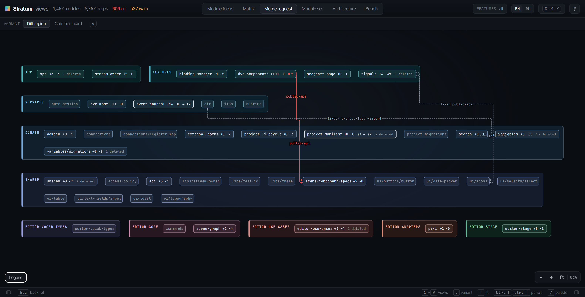
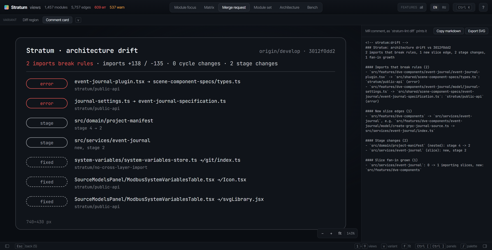
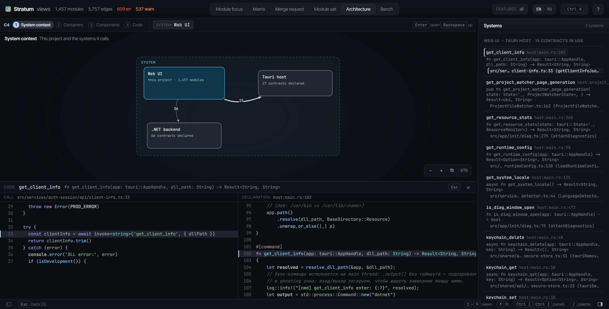
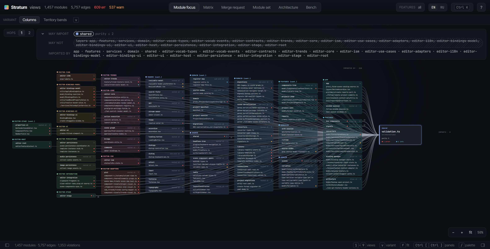
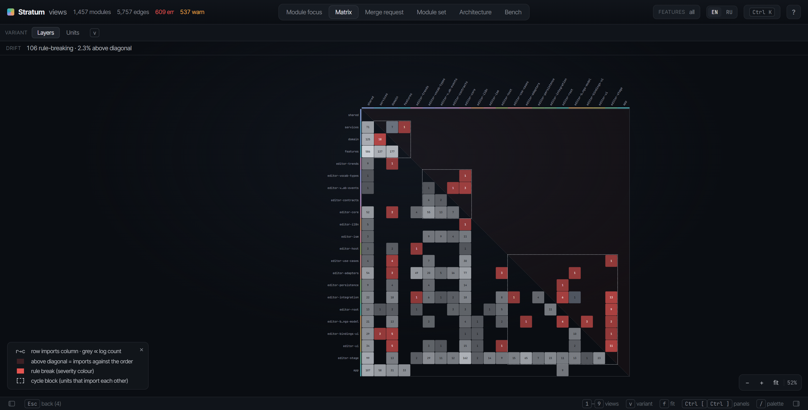

<div align="center">


# Stratum

**A universal architecture linter for TypeScript, JavaScript and Vue.**<br/>
Fast enough to run on every edit, written for AI coding agents and CI.

[](https://github.com/PetukhovArt/stratum/actions/workflows/ci.yml)
[](https://www.npmjs.com/package/@petukhovart/stratum-lint)
[](LICENSE)
[](https://github.com/PetukhovArt/jig)

<a href="docs/assets/visualizer-merge-request.webp"></a>

</div>

## What is Stratum

Stratum checks that the imports in a codebase follow its architecture. You describe the layers, for example `shared → entities → features → pages`, and which of them may import which. Stratum builds the module graph and reports each import that breaks a rule, together with the fix.

It started as part of [jig](https://github.com/PetukhovArt/jig). AI coding agents write code fast and quietly break the layering a team agreed on, and review finds it late or not at all. The check had to run after every edit of an agent, finish in a fraction of a second on a large project and tell the agent what to change. Stratum is that check, and it works the same for people and for CI.

## Why Stratum

- **Better code through deterministic checks.** The architecture is a config, not a habit. 24 rules check layers, cycles, public APIs, folder structure and dead code the same way on every run, for people and agents alike.
- **Fewer review tokens.** An agent gets each break with a `fix` right after its edit and repairs it on its own. Review no longer spends tokens or time on imports and folders.
- **An architecture health check in CI.** Native GitLab and GitHub reports, and a ratchet against a `baseline`: the debt of today is accepted, any new break fails the pipeline.
- **A replacement for slow ESLint boundary rules.** Rust, a graph cache and a git-aware scope: about 0.15 s for the changed files of a 4,000-module project. A config translates from eslint-plugin-boundaries.
- **A visual merge request.** `diff --base main` and the visualizer show what an MR changes: new imports, broken rules and fixed ones, as a comment card or a graph.
- **Fits any project on its stack.** TypeScript, JavaScript and Vue. Layers, slices, segments and private zones come from your config or a preset (`stratum:recommended`, `stratum:fsd`); no folder name is wired in. Custom rules in Rhai, no rebuild.

### What it builds on

The rules are known engineering principles turned into checks on the import graph:

- **Layered architecture and the dependency rule** (Clean Architecture, Feature-Sliced Design): code depends only on the layers below it. `no-cross-layer-import`, `import-policy`.
- **Acyclic dependencies principle**: no import cycles. `no-circular-deps`.
- **Information hiding** (Parnas): other code uses a module only through its entry file; its internals and private zones stay private. `public-api`, `visibility-scope`, `sibling-isolation`, `no-barrel`.
- **Functional core, imperative shell**: pure code does not import code with side effects. `purity`.
- **Deep modules** (Ousterhout, *A Philosophy of Software Design*): a small interface with much behind it. `deep-module`, `depth-ratio`.
- **Miller's 7 ± 2**: a folder or a module stays small enough to keep in mind. `container-breadth`, `zone-breadth`, `miller-limit`, `slice-fan-in`.
- **Stable dependencies principle**: code that many slices use moves to a lower layer. `promotion-pressure`.
- **Structure that grows in stages**: a slice grows from a file to a folder, then to segments, then to sub-units, and never mixes two stages. `stage-mixing`, `composer-scope`.
- **Change coupling**: files that must change together do. `co-change`.
- **No dead code**: `unused-exports`, `unreachable-modules`, `unused-dependencies`.
- **Baseline and ratchet**: accept the debt of today, block new debt.
- **C4 model**: the visualizer goes from systems to containers, components and code.

## Quick start

```sh
npm install -g @petukhovart/stratum-lint
stratum-lint init                         # write a config inferred from your folders
stratum-lint --changed --format agent     # check what you changed
```

<table>
<tr>
<td width="50%"><a href="docs/assets/visualizer-comment-card.webp"></a></td>
<td width="50%"><a href="docs/assets/visualizer-contract.webp"></a></td>
</tr>
<tr>
<td align="center"><sub>The merge request as a comment: rule breaks, stage changes, fixes</sub></td>
<td align="center"><sub>Contracts across systems: the TypeScript call beside its Rust command</sub></td>
</tr>
<tr>
<td width="50%"><a href="docs/assets/visualizer-focus.webp"></a></td>
<td width="50%"><a href="docs/assets/visualizer-matrix.webp"></a></td>
</tr>
<tr>
<td align="center"><sub>A module, everyone who imports it and the layers it may import</sub></td>
<td align="center"><sub>Layer matrix: imports against the order sit above the diagonal</sub></td>
</tr>
</table>

## Integrations

Stratum is a standalone CLI and LSP server; every integration below is optional.

| Where | How |
|---|---|
| Claude Code | the [`stratum` plugin](claude-plugin/README.md); optional warm diagnostics through [`stratum-lsp`](claude-plugin-lsp/README.md) |
| Codex, Cursor, other agents | paste [docs/agents-snippet.md](docs/agents-snippet.md) into `AGENTS.md` |
| GitLab, GitHub CI | native report formats and a baseline check: [docs/ci.md](docs/ci.md) |
| Any tool | the JSONL contract and exit codes: [docs/harness.md](docs/harness.md) |
| [jig](https://github.com/PetukhovArt/jig) | runs Stratum after each edit and blocks the end of a turn while new errors remain |

<details>
<summary><b>Install</b></summary>

- npm, all platforms: `npm install -g @petukhovart/stratum-lint` (ships `stratum-lint` and `stratum-lsp`)
- Windows (x64, arm64): `scoop bucket add stratum https://github.com/PetukhovArt/scoop-stratum-bucket`, then `scoop install stratum-lint`
- macOS, Linux (x64, arm64): `brew tap petukhovart/stratum`, then `brew install stratum-lint`
- From source: `cargo install --path crates/stratum-lint` and `cargo install --path crates/stratum-lsp`

Source files: `.ts .tsx .mts .cts .js .jsx .mjs .cjs .vue` (Vue: `<script>` and `<script setup>`).

</details>

<details>
<summary><b>Rules</b></summary>

`stratum-lint rules` lists the active ones; `stratum-lint explain <slug>` prints what, why, fix and options.

| Rule | Reports |
|---|---|
| `stratum/no-cross-layer-import` | An import from a layer outside the importer's own layer and its `depends_on`. |
| `stratum/no-circular-deps` | Every import cycle, one violation per cycle. |
| `stratum/purity` | A module importing a less pure one (`// @stratum-purity N`, 1 pure to 4 side effects, default 2). |
| `stratum/visibility-scope` | An import into a private-zone folder from outside that folder's parent. |
| `stratum/public-api` | An import from outside a slice, sub-unit or nested container that bypasses its entry file. |
| `stratum/sibling-isolation` | An import between two slices or sub-units that share a parent container. |
| `stratum/import-policy` | Imports denied by `from` / `deny` / `allow` / `slice` globs declared in config. |
| `stratum/reachability-policy` | A module matching `deny` that a `from` file reaches through a chain of imports, with the chain. |
| `stratum/co-change` | On a diff (`--changed`, `diff --base`): a changed file matching `when` without any changed file matching `require`, in the same `slice` directory when the policy sets one. |
| `stratum/restricted-calls` | A call to a listed function outside the files its policy allows. |
| `stratum/stage-mixing` | A container holding segment folders next to sub-unit folders or other plain domain folders. |
| `stratum/container-breadth` | A folder holding too much directly inside it: more than `max_kinds` kinds in a container, more than `max_items` items in a segment, collection or sliced layer root, more than `max_root_files` files at a composer's root. |
| `stratum/zone-breadth` | A private zone with more than `max_kinds` kinds of children. |
| `stratum/missing-entry` | A folder with segment or private-zone children but no entry file. |
| `stratum/unclaimed-folder` | A folder directly in a layer listed in `layers` that no declared layer, private zone, segment or `allow` glob claims, so it silently gets that layer's `depends_on`. |
| `stratum/no-barrel` | An entry file that only re-exports (barrel) inside a segment folder, or at the root of a layer listed in `layers`. |
| `stratum/composer-scope` | A stage-4 composer whose private zone has no file matching `scope_file`. |
| `stratum/naming` | A folder name outside `folder_case`, listed in `reserved`, or a duplicate or plural slice name. |
| `stratum/module-docs` | A navigation doc (`nav_file`) missing, misplaced, or contradicting the folder's imports. |
| `stratum/unused-exports` | An export that no module reachable from `project.entry_points` imports. |
| `stratum/unreachable-modules` | A module that no file in `project.entry_points` reaches. |
| `stratum/unused-dependencies` | A package.json dependency nothing imports, or an imported package package.json does not declare. |
| `stratum/suppression` | A `stratum-ignore` directive without a reason or with an unknown slug, or one that suppresses nothing; with `forbid`, a foreign directive such as `eslint-disable` or `@ts-ignore`. |
| `stratum/slice-fan-in` | A slice imported by more than `max_fan_in` other slices. |
| `stratum/miller-limit` | A module with more than `max_children` importers from outside its slice (else its layer) whose layers may import it. |
| `stratum/promotion-pressure` | A module with at least `threshold` importers from outside its slice (else its layer) whose layers do not declare its layer: a candidate for a lower layer. |
| `stratum/deep-module` | A module exporting more than `max_exports` names. |
| `stratum/depth-ratio` | A module whose ratio of modules in its slice (else its layer) to its exports is below `min_ratio`. |

</details>

## Docs

[Configuration](docs/configuration.md) · [Rules and options](docs/custom-rules.md) · [Visualizer](docs/visualizer.md) · [Agent contract](docs/harness.md) · [CI](docs/ci.md) · [Glossary](UBIQUITOUS_LANGUAGE.md) · [Changelog](CHANGELOG.md)

MIT © Artem Petukhov
