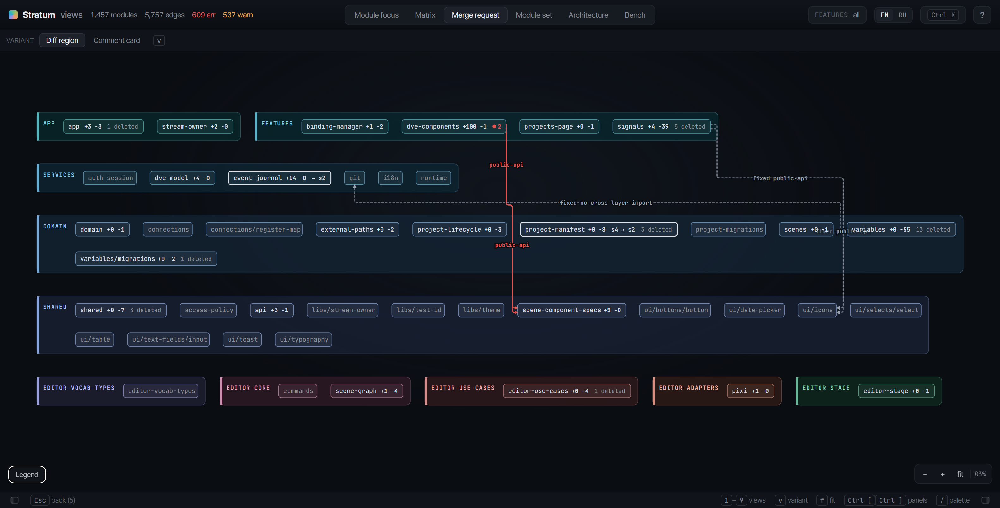

# `@petukhovart/stratum-lint`

npm package for the [Stratum](https://github.com/PetukhovArt/stratum) architecture linter: the `stratum-lint` CLI.

[](https://raw.githubusercontent.com/PetukhovArt/stratum/main/docs/assets/visualizer-merge-request.webp)

```
npm install -g @petukhovart/stratum-lint
```

The binary comes in one optional dependency per platform (`@petukhovart/stratum-lint-<platform>-<arch>`, listed under `optionalDependencies`), so install runs no scripts, works with `--ignore-scripts`, and needs only the npm registry or its proxy. When npm skipped the platform package (`--omit=optional`, a lockfile written on another platform), `stratum-lint` exits with code 2 and names the missing package.
